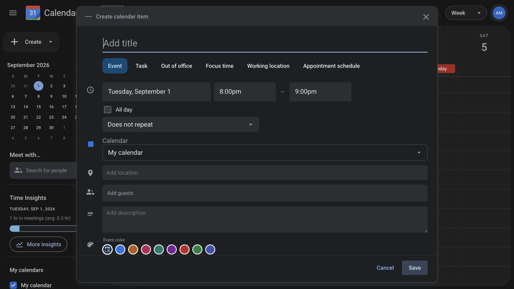

<h1 align="center">Calendar</h1>

<p align="center">
  A HackerRank sample repo for personal scheduling and team coordination.
</p>



## Built With

- [React 19](https://react.dev/) and [Vite 8](https://vite.dev/) for the frontend
- [Bun](https://bun.sh/) for workspace installation and JavaScript execution
- [Express 5](https://expressjs.com/) for the HTTP API
- [MongoDB](https://www.mongodb.com/) and [Mongoose](https://mongoosejs.com/) for persistence
- [Zod](https://zod.dev/) for request validation
- [JSON Web Tokens](https://jwt.io/) and [bcrypt](https://github.com/dcodeIO/bcrypt.js) for authentication

## Project Structure

```text
.
├── backend/                     # Express API, business logic, and MongoDB persistence
│   ├── __tests__/               # Jest API and logic tests
│   └── src/
│       ├── features/            # Product domains and API flows
│       ├── scripts/             # Deterministic seed data
│       └── shared/              # Configuration, authentication, and utilities
├── frontend/
│   ├── src/__tests__/           # Vitest component tests
│   ├── src/features/            # Product views and interactions
│   ├── src/shared/              # API client, reusable controls, and utilities
│   └── public/                  # Local static media
├── .vscode/launch.json          # Backend debugger configuration
├── hackerrank.yml               # HackerRank install, run, test and scoring configuration
└── setup.sh                     # MongoDB readiness and seed reset
```

## Getting Started

### Prerequisites

- Bun 1.3 or later
- MongoDB 8.0 or later on `127.0.0.1:27017`

### Development Setup

1. Clone the repository.

   ```bash
   git clone https://github.com/ProblemSetters/coderepo-react-node-calendar.git
   ```

2. Open the project directory.

   ```bash
   cd coderepo-react-node-calendar
   ```

3. Install the pinned workspaces.

   ```bash
   bun install
   ```

4. Start the complete application.

   ```bash
   bun start
   ```

   Startup checks MongoDB, restores the seeded baseline, and launches the frontend and backend.

5. Open [http://localhost:3000](http://localhost:3000) and sign in.

   ```text
   Email: alex.morgan@calendar.com
   Password: password123
   ```

   Choose any seeded profile to enter the calendar workspace.

The frontend runs on port `3000`, the API runs on port `8000`, and health is available at [http://localhost:8000/api/v1/health](http://localhost:8000/api/v1/health).

### Commands

| Command | Purpose |
|---|---|
| `bun start` | Seeds MongoDB and starts the frontend and backend together. |
| `bun run seed` | Restores the deterministic MongoDB baseline. |
| `bun run dev:backend` | Starts only the Express API on port `8000`. |
| `bun run dev:frontend` | Starts only Vite on port `3000`. |
| `bun run test` | Runs the backend and frontend tests and writes all results to `output/junit.xml`. |
| `bun run test:backend` | Runs only the backend tests (Jest). |
| `bun run test:frontend` | Runs only the frontend tests (Vitest). |

HackerRank installs the application with `bun install && bash setup.sh --seed`, runs it with `bun start`, and runs the tests with `bun run test`.

The backend tests need MongoDB, which Install and Run start. They never touch the app's own data: each run uses its own `calendar_db_test_<id>` database and drops it when it ends. Only `bun run test` writes `output/junit.xml`; `test:backend` and `test:frontend` print their results only.
